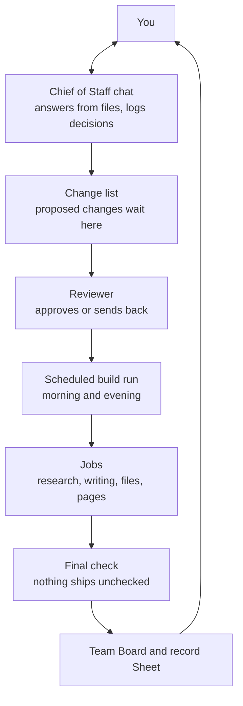

# chief-of-staff-agents

A template for running a one-person business with a staff of AI agents, built inside Claude. You talk to one chat, the Chief of Staff. Behind it, scheduled agents build, review, budget and deliver, and nothing ships until a separate reviewer has checked it.

I built this to run an education product business and my daily operations, so I could work long hours from home with a young child. This repo is the system with everything personal removed: the roles, the rules, the record, the daily schedule and the job prompts.

## The shape

The chat that talks to you can't change a job. It writes the change to a list. A reviewer approves it, and a scheduled run applies it. Proposing, approving and doing are three different agents.

## Five rules that made it trustworthy

The first version was one big chat that planned, built and checked its own work. It reported work as done when it wasn't, and it forgot decisions overnight. These rules came out of an exit review of that chat.

1. **Done means the file exists and someone opened it.** An agent reports done only with the path and the time it read the file back.
2. **The chat that talks doesn't build.** Proposing, approving and doing are separate.
3. **Files over memory.** Every answer starts from the record. If the record doesn't say, the answer is "I don't know", and the agent goes and looks.
4. **Only real decisions reach the person.** Money, anything public, deletions and changes to the rules come as one problem line and one solution line. Everything else gets decided and logged.
5. **Fix the step that failed.** When a mistake repeats, the fix goes into the job that failed and names what it removes. No new rule just to show the miss was heard.

## The day

| When | Job | What it does |
|---|---|---|
| 4:00 AM | Build run, morning | Applies approved changes and writes the block the brief reads |
| 4:30 AM | Morning brief | One pinned page with the day, ready by 5:00 |
| All day | Chief of Staff chat | Takes questions and decisions, answers from the record |
| 6:30 PM | Comptroller | Reads usage, prices each job, splits overhead from production |
| 7:00 PM | Grader | Grades each run by whether its output exists and matches its source |
| 8:30 PM | Build run, evening | Second pass on the change list, writes tomorrow's handoff |
| Sunday | Senior review | A stronger model reviews the week and the system itself |

Repeating jobs get fixed slots on the hour or half hour. One-time jobs only go in the gaps. Anything that feeds the brief finishes before it.

## Budget

Usage is a weekly allowance, so it gets run like a crew's budget.

- The Comptroller prices every job and splits overhead (keeping the system running) from production (making things). Running the system has a weekly cap.
- Work goes to the cheapest worker that passes: a script first, then the cheapest model that does the job, and a bigger model only when the work fails a check.
- Near the weekly limit the system cuts back on its own, like a phone in low power mode. New build work stops at 95%, and everything stops at 99%.
- Any batch job runs a small trial first and gets checked before it runs at full size.

## What's in this repo

- `roles/` holds the role page for the Chief of Staff and the prompts for the Comptroller, Grader, build run and senior review.
- `rules.md` is the house rules every agent loads.
- `record/schema.md` describes the record Sheet tabs: Runs, Outputs, Decisions, Misses, Open items, To Review, Scoreboard and Jobs.
- `templates/` has the change list format and the exit review.
- `LESSONS.md` covers what broke, what an independent review found, and the research each part came from.

## Run it yourself

1. Make a Google Sheet with the tabs in `record/schema.md`, and a Drive folder for the role page and rules.
2. Set your preferences in Claude so every chat reads the role page first.
3. Create the scheduled tasks in `roles/`, each with its time from the table above.
4. Name one chat "Chief of Staff" and pin it. Talk only to it.

---

Built by [Miles Gray](https://github.com/xmilesx).
